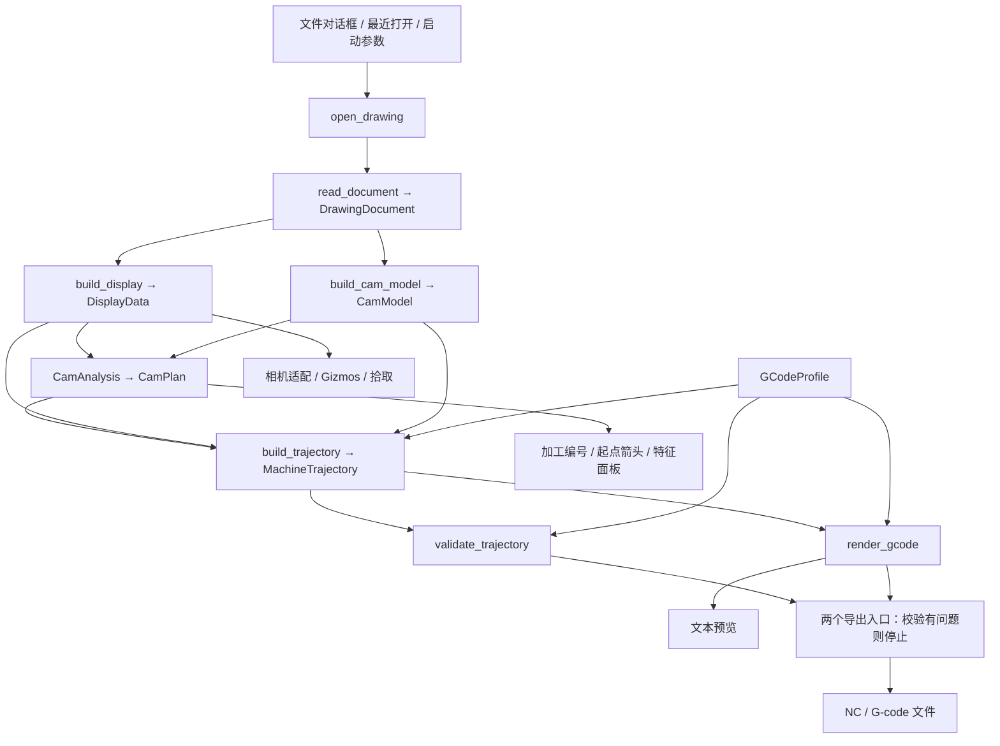

# 架构

[返回项目入口](../README.md) · [使用指南](使用指南.md) · [已知限制](已知限制.md)

本文按 2026-10-23 当前工作区源码整理，描述已实现的结构与行为。操作方法见使用指南，实现缺口集中在已知限制中。

## 分层与依赖

Workspace 包含 `cad-core` 和 `cad-app`，默认成员为 `cad-app`。依赖方向为 `cad-app → cad-core`。

| 模块 | 职责与入口 |
|---|---|
| [cad-core/src/lib.rs](../crates/cad-core/src/lib.rs) | 对外暴露 `read_document`、`ImportError` 和独立领域模型 |
| [import/](../crates/cad-core/src/import/mod.rs) | 私有：格式识别、failsafe 解析、可用性检查、错误转换 |
| [convert.rs](../crates/cad-core/src/convert.rs) | 私有：模型空间转换、OCS 到 WCS、图层补全、单位及导入报告 |
| [model/](../crates/cad-core/src/model/mod.rs) | 文档、实体、图层、ID、六类几何；无 UI/渲染依赖 |
| [display.rs](../crates/cad-app/src/display.rs) | `build_display`：显示折线、颜色、属性、包围盒及圆/圆弧元数据 |
| [cam.rs](../crates/cad-app/src/cam.rs) | `build_cam_model`：端点焊接、连通分组、实体到加工单元的映射 |
| [cam_analysis.rs](../crates/cad-app/src/cam_analysis.rs) | `CamAnalysis`：截面/断面、区间/组/区位、顺序、方向和起点 |
| [cam_trajectory.rs](../crates/cad-app/src/cam_trajectory.rs) | `build_trajectory`：加工路径到 X/Y/Z/A 运动及单元范围 |
| [gcode.rs](../crates/cad-app/src/gcode.rs) | 配置、`validate_trajectory` 基础校验、`render_gcode` 文本生成 |
| [main.rs](../crates/cad-app/src/main.rs) | 应用状态、Bevy 系统、egui、相机、选择、重算、预览及导出 |

`cad-core` 不依赖 Bevy/wgpu/egui；`acadrust` 类型限制在 import/convert 边界，不进入公开领域模型。CAM 分析和轨迹模块不依赖 Bevy/egui，但目前依赖显示适配层的数据。

## 主数据流

`open_drawing` 在主线程同步完成读取、离散、拓扑、分析和轨迹生成；成功后更新 `ViewerState`、增加 `load_version` 并标记相机适配。失败时记录错误并保留原图纸。当前 `ViewerState` 不持有完整 `DrawingDocument`，只保留来源摘要和派生数据。

## 领域模型与导入

- `DrawingDocument` 包含单位、图层、实体、来源和导入报告。`EntityId`/`LayerId` 是内部顺序 ID，不是文件句柄，当前与数组下标对应。
- `Geometry` 包含 Line、Polyline、Circle、Arc、Ellipse、Spline，WCS 坐标为 `f64`；平面曲线保留平面或轴向基。
- 多段线保存直线和圆弧段，闭合段已包含在列表内；样条保存控制点、节点、权重、拟合点及源标记。
- 格式识别优先使用内容签名和特征，扩展名作回退及诊断。acadrust 使用 failsafe 解析，并拒绝没有可用绘图记录的结果。
- 转换仅处理模型空间，未支持或失败实体写入报告；最多保留 256 个跳过样本，另计省略数。解析诊断合并到警告列表。

## 显示、坐标与选择

`DisplayData` 保存带实体 ID 的彩色路径、图元属性、图层、包围盒，以及独立圆/圆弧的圆心和法向。样条使用 de Boor 求值，不完整数据可回退为控制多边形；显示路径过滤非有限坐标。

CAD 到 Bevy 的显示映射为 `(x, y, z) → (x, z, -y)`，不做单位换算。相机为三维正交轨道相机，按当前朝向投影包围盒适配缩放。线框及坐标轴通过 `Gizmos` 逐帧绘制。

`SelectionState` 分别持有实体和加工单元 ID。切换空间时通过成员映射选择；换图纸通过 `load_version` 清理旧选择。拾取计算屏幕投影线段距离，框选区分全包含和相交。`UiState` 与 egui 指针状态用于阻止界面操作透传。

## CAM 拓扑与分析

### 加工单元

`build_cam_model` 从领域几何取端点，以 `1e-3` 图纸单位容差进行空间哈希焊接及并查集分组。完整圆、完整椭圆、闭合多段线及闭合/周期样条独立成单元；开放实体连通组的节点度全为 2 时标记闭合。

`MachiningUnit.members` 按实体 ID 排序，并非加工顺序。`UnitId` 是规范化成员集合的 FNV-1a 哈希；相同内部成员集合保持同一身份，不保证源文件实体顺序变化后仍对应原对象。

### 截面、断面、区间与区位

1. 从所有闭合单元的 YZ 包络估计管材中心、尺寸和圆角；当前至多生成一个候选，单一候选自动采用。
2. 将闭合路径投影到管材周界，检查表面偏差、周向覆盖和 `±1` 绕数；周界覆盖使用 512 个桶。
3. 最大偏差不超过 `0.05` 且缺口桶数不超过 1 的高置信候选自动成为加工断面；其他候选可手动应用，也可手动指定闭合单元。
4. 断面按 X 排列，派生 `MachiningInterval` 和 `MachiningGroup`；组内普通单元先加工，组末断面承担切断语义。
5. `UnitZoneProfile` 记录区位投影长度及经过标记，以最长投影选主区位。16 区位由 4 个面、4 个圆角、8 个过渡组成，界面方位名称以 `TubeZone::label` 为准。

### 计划、方向与起点

`CamPlan → PlanGroup → PlanUnit` 保存顺序、区位、断面标记、方向和起止点。

- 懒旋转按区位遍历，再按单元 X 中心排序；关闭后按单元最小 X 排序，以区位顺序和 ID 打破并列。顺逆时针影响区位顺序。
- 组末断面固定在最后；普通单元支持组内上下移动和 Ctrl 点击重排。
- 起点选择结合虚拟扫描入口、前一出口方向、接近方向、A 角变化和距离。首加工断面优先从上表面靠近配置初始位置处进入，末断面尝试承接前一区位。
- 当前工作区的整计划重建在非懒旋转模式下跨组传递出口状态；组内手动重排仍从局部空状态计算，不能视为已验证的全计划连续优化。
- 无截面时清除截面/区位分析，按最小 X 排序，以前一终点选择方向，生成单个回退加工组。

`ordered_unit_points` 从显示路径贪心拼接加工路径，`oriented_unit_path_from` 反向或旋转闭合路径起点；尚无独立的加工公差几何层。

## 四轴运动与 G-code

`MachineTrajectory` 保存运动段、单元运动范围、规则键、安全 Z、A 范围及统计。运动类型为 `Rapid`、`Cutting`、带平面/圆心/方向的 `Arc`。

有截面时围绕截面中心生成绕 X 的旋转姿态，按面/圆角或径向模式求 A，支持角度展开、加工 Z 偏移和闭合路径切向过切。同区位且 A 相同的转移采用同区离面策略，其他转移先抬到安全 Z。无截面时使用原 XYZ 和固定 A 偏移，不应用过切或加工 Z 偏移。

单实体圆/圆弧在 A 恒定且符合当前识别条件时尝试压缩为圆弧运动；其余输出切削折线。文本层处理文件/单元头尾、类型/图层/颜色规则、进给、精度和换行；关闭圆弧输出时按 `arc_tolerance` 展开语义圆弧。初始位置和结束返回由文本层追加，不属于缓存运动列表。

普通/快速导出均执行基础校验，有问题则停止；配置窗口预览直接渲染。校验范围和遗漏见[已知限制](已知限制.md)。

## 状态更新入口

| 触发动作 | 当前更新路径 |
|---|---|
| 成功打开图纸 | 重建显示、拓扑、分析、初始位置参考和轨迹；清理旧选择、适配相机 |
| 应用/清除截面、增删断面、面板排序或策略变化 | 更新分析/计划并重建轨迹；不统一刷新已有文本预览 |
| Ctrl 点击重排 | 更新组内计划，重建轨迹并刷新预览 |
| 保存配置成功 / 重新加载 | 同步初始位置参考，必要时重建计划，再重建轨迹及预览 |
| 刷新预览 | 用当前缓存轨迹及内存配置渲染，不重建轨迹 |
| 校验 / 导出 | 使用当前缓存轨迹和内存配置，不自动应用或重算 |

手动计划只保存在内存，没有项目文件、撤销栈或计划持久化。当前多个刷新入口并非统一事务，修改时需核对预览与最终导出的一致性。
