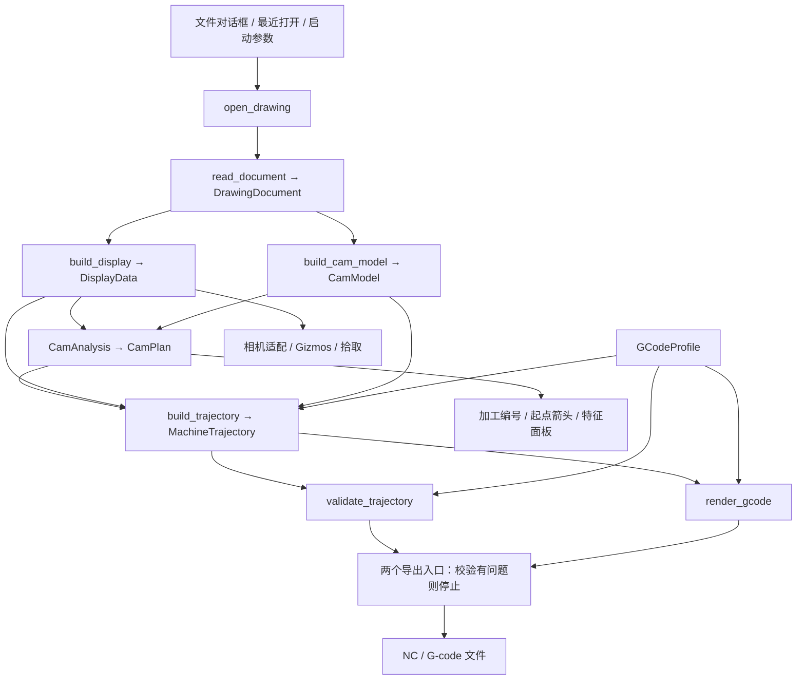

# 架构

[返回项目入口](../README.md) · [使用指南](使用指南.md) · [已知限制](已知限制.md)

本文按 2026-10-24 当前工作区源码整理，描述已实现的结构与行为。操作方法见使用指南，实现缺口集中在已知限制中。

## 分层与依赖

Workspace 包含 `cad-core` 和 `cad-app`，默认成员为 `cad-app`。依赖方向为 `cad-app → cad-core`。

| 模块 | 职责与入口 |
|---|---|
| [cad-core/src/lib.rs](../crates/cad-core/src/lib.rs) | 对外暴露 `read_document`、`ImportError` 和独立领域模型 |
| [import/](../crates/cad-core/src/import/mod.rs) | 私有：格式识别、failsafe 解析、可用性检查、错误转换 |
| [convert.rs](../crates/cad-core/src/convert.rs) | 私有：模型空间转换、OCS 到 WCS、图层补全、单位及导入报告 |
| [model/](../crates/cad-core/src/model/mod.rs) | 文档、实体、图层、ID、六类几何；无 UI/渲染依赖 |
| [display.rs](../crates/cad-app/src/display.rs) | `build_display`：显示折线、颜色、属性、包围盒及圆/圆弧元数据 |
| [cam.rs](../crates/cad-app/src/cam.rs) | `build_cam_model`：端点焊接、连通分组、实体到加工单元的映射 |
| [cam_analysis.rs](../crates/cad-app/src/cam_analysis.rs) | `CamAnalysis`：截面/断面、区间/组/区位、顺序、方向和起点 |
| [cam_trajectory.rs](../crates/cad-app/src/cam_trajectory.rs) | `build_trajectory`：加工路径到 X/Y/Z/A 运动及单元范围 |
| [cam_wall.rs](../crates/cad-app/src/cam_wall.rs) | 内壁投影及局部斜率、壁厚单向 X 附加量 |
| [gcode.rs](../crates/cad-app/src/gcode.rs) | 配置、`validate_trajectory` 基础校验、`render_gcode` 文本生成 |
| [main.rs](../crates/cad-app/src/main.rs) | 应用状态、Bevy 系统、egui、相机、选择、重算、全屏配置及导出 |

`cad-core` 不依赖 Bevy/wgpu/egui；`acadrust` 类型限制在 import/convert 边界，不进入公开领域模型。CAM 分析和轨迹模块不依赖 Bevy/egui，但目前依赖显示适配层的数据。

## 主数据流

`open_drawing` 在主线程同步完成读取、离散、拓扑、分析和轨迹生成；成功后更新 `ViewerState`、增加 `load_version` 并标记相机适配。失败时记录错误并保留原图纸。当前 `ViewerState` 不持有完整 `DrawingDocument`，只保留来源摘要和派生数据。

## 领域模型与导入

- `DrawingDocument` 包含单位、图层、实体、来源和导入报告。`EntityId`/`LayerId` 是内部顺序 ID，不是文件句柄，当前与数组下标对应。
- `Geometry` 包含 Line、Polyline、Circle、Arc、Ellipse、Spline，WCS 坐标为 `f64`；平面曲线保留平面或轴向基。
- 多段线保存直线和圆弧段，闭合段已包含在列表内；样条保存控制点、节点、权重、拟合点及源标记。
- 格式识别优先使用内容签名和特征，扩展名作回退及诊断。acadrust 使用 failsafe 解析，并拒绝没有可用绘图记录的结果。
- 转换仅处理模型空间，未支持或失败实体写入报告；最多保留 256 个跳过样本，另计省略数。解析诊断合并到警告列表。

## 显示、坐标与选择

`DisplayData` 保存带实体 ID 的彩色路径、图元属性、图层、包围盒，以及独立圆/圆弧的圆心和法向。样条使用 de Boor 求值，不完整数据可回退为控制多边形；显示路径过滤非有限坐标。

CAD 到 Bevy 的显示映射为 `(x, y, z) → (x, z, -y)`，不做单位换算。相机为三维正交轨道相机，按当前朝向投影包围盒适配缩放。线框及坐标轴通过 `Gizmos` 逐帧绘制。

`SelectionState` 分别持有实体和加工单元 ID。切换空间时通过成员映射选择；换图纸通过 `load_version` 清理旧选择。拾取计算屏幕投影线段距离，框选区分全包含和相交。`UiState` 与 egui 指针状态用于阻止界面操作透传。

## CAM 拓扑与分析

### 加工单元

`build_cam_model` 从领域几何取端点，以 `1e-3` 图纸单位容差进行空间哈希焊接及并查集分组。完整圆、完整椭圆、闭合多段线及闭合/周期样条独立成单元；开放实体连通组的节点度全为 2 时标记闭合。

`MachiningUnit.members` 按实体 ID 排序，并非加工顺序。`UnitId` 是规范化成员集合的 FNV-1a 哈希；相同内部成员集合保持同一身份，不保证源文件实体顺序变化后仍对应原对象。

### 截面、断面、区间与区位

1. 从所有闭合单元的 YZ 包络估计管材中心、尺寸和圆角；当前至多生成一个候选，单一候选自动采用。
2. 将闭合路径投影到管材周界，检查表面偏差、周向覆盖和 `±1` 绕数；周界覆盖使用 512 个桶。
3. 最大偏差不超过 `0.05` 且缺口桶数不超过 1 的高置信候选自动成为加工断面；其他候选可手动应用，也可手动指定闭合单元。
4. 断面按轴向中心位置两两配对，也可手工指定；`MachiningGroup` 保存 `left_section/right_section`，由同一组生成 `MachiningInterval`。修边及未归属单元保留在独立组，断面不再按相同最小 X 去重。普通单元按全部路径采样与两侧局部边界比较归属；交叉、重叠或归属歧义进入 `grouping_errors`，轨迹与导出共用。
5. `UnitZoneProfile` 记录区位投影长度及经过标记，以最长投影选主区位。16 区位由 4 个面、4 个圆角、8 个过渡组成，界面方位名称以 `TubeZone::label` 为准。

### 计划、方向与起点

`CamPlan → PlanGroup → PlanUnit` 保存顺序、区位、断面标记、方向和起止点。

- 懒旋转按区位遍历，再按单元 X 中心排序；关闭后按单元最小 X 排序，以区位顺序和 ID 打破并列。顺逆时针影响区位顺序。
- 组外/修边组先执行；成品组固定为左端面、普通单元、右端面。`end_cut_side` 从成品组边界推导。普通单元支持组内上下移动和 Ctrl 点击重排，插入位置限制在两端之间。
- 普通单元统一按自身几何选入口，不依赖前一单元或前一断面的出口。非懒旋转选 X 最大点；懒旋转优先局部北极点，不可用于主区位时尝试南极点，再回退到主区位内的极值点。局部北向定义为区位转至朝上加工姿态后的横向 +Y，圆角采用区位中部的切平面方向。
- 闭合单元在显示路径采样点中选极点；开放单元只在两端选，避免从中间开切漏段。懒旋转优先选择初始切向朝 +X 的遍历方向；非懒旋转按顺逆时针选择初始局部周向切向。此规则不等于强制所有 A 轴运动单向。
- 完整计划重建、上下移动和 Ctrl 重排均调用 `refresh_plan_entries`，保留当前排序并统一刷新起止点和编号。普通单元不再做前后夹角、A 角变化及距离评分。
- 切断断面保留独立入口：首断面优先从上表面靠近配置初始位置处进入，末断面尝试承接前一区位；未命中特殊规则时按前一终点选择路径正反向。非懒旋转时断面参考状态可跨组传递，懒旋转在组首重置。
- 无截面时清除截面/区位分析，按最小 X 排序，以前一终点选择方向，生成单个回退加工组。

`ordered_unit_points` 从显示路径贪心拼接加工路径，`oriented_unit_path_from` 反向或旋转闭合路径起点；尚无独立的加工公差几何层。

## 四轴运动与 G-code

`MachineTrajectory` 保存运动段、单元运动范围、规则键、安全 Z、A 范围、统计及构建错误。运动类型为 `Rapid`、`Cutting`、带平面/圆心/方向的 `Arc`。

有截面时围绕截面中心生成绕 X 的旋转姿态，按面/圆角或径向模式求 A，支持角度展开、加工 Z 偏移和闭合路径切向过切。`flat_surface` 确认前后普通单元处于同一水平面、同区位且实际 A 不变时，由 `transfer_moves` 生成联动或旧离面转移；圆角、切断边界、跨面和旋转使用净空策略。安全 Z 包含截面/图纸 YZ 矩形半对角线及正加工 Z 偏移。无截面时使用原 XYZ 和固定 A 偏移，不应用过切或加工 Z 偏移。

未启用壁厚端面补偿的单元，Z 非零且 A 变化时，`section_cut_direction` 只用各圆角采样求 `x = a*y + b*z + c` 的方向，再验证一致性；直角使用顶点相邻边，恒 X 断面直接返回零斜率。其他跨区位单元由 `fit_cut_direction` 检查整体是否有可靠的平面方向。过切点不参与方向拟合。每个姿态按 `ΔX = machining_z_offset * (a*sin(A) + b*cos(A))` 修正 X，源点自身的曲线形状保留；Y/Z/A 继续使用原姿态解算。修正先于进场、圆弧压缩和单元转移，因此入口及实际过切末姿态一致。失败返回含具体原因的空轨迹，面板显示错误，渲染返回空文本，两个导出入口均通过校验拒绝输出。

单元内部的几何 A 始终连续展开，不受 ±180° 限制。`wrap_angle_180` 归一化几何方向及偏移，`unwrap_angle` 选择靠近前点的等价角度；`align_entry_angle` 在开启连续角度时将单元入口衔接至上一末姿态，即使关闭也不让精确等价的入口多转整圈。无截面回退使用同一入口规则。结束返回同样取靠近末姿态的等价 A。`transfer_moves` 消除等价角度差，真实旋转仍经净空；交界处不拆分切削、不插入回转。角度及姿态需为有限数值，A 范围和切削段数反映实际运动。

单实体圆/圆弧在 A 恒定且符合当前识别条件时尝试压缩为圆弧运动；其余输出切削折线。文本层处理文件/单元头尾、类型/图层/颜色规则、进给、精度和换行；关闭圆弧输出时按 `arc_tolerance` 展开语义圆弧。初始位置、首个进场及结束返回均由轨迹层生成，属于单元运动范围；文本层不另加首尾移动。`TransferConfig` 是 TOML 配置、剖面示意和实际轨迹共用的参数；示例距离和高度差只存于界面状态。

文本层按连续切削段启停：切削转入 `Rapid` 时先输出单元结束及规则尾部，重新切削时输出规则头部和单元开始代码，保证默认 M03/M05 包围切削段。两个导出入口消费相同的连续角度轨迹，配置窗口不生成或显示 G 代码文本。

`build_trajectory` 先生成含机床 Z 偏移、X 仍为源点 X 的姿态。启用壁厚端面补偿时，`cam_wall::end_cut_allowance` 将该实际姿态反变换到工件坐标，沿激光方向取一个壁厚的候选点，再由 `project_inner` 直接投影到内轮廓；不执行射线穿透或相切判定。局部方向以源点为锚给出内壁期望 X 与源点 X 的差值，仅对这一差值应用左端非负、右端非正的限制。该路径沿用旧项目的统一修正方式，不再额外叠加 Z/X 联动；Z 高度在基础姿态中只施加一次。内圆角小于等于零时使用直角内轮廓。补偿只修改派生姿态，源 CAD 和组归属不变；几何采样修正后延伸过切，并保留闭合末端的累计 A。所有成品组完成后检查补偿后的左右空间，失败返回明确构建错误。

普通/快速导出均重建轨迹并执行基础校验，有问题则停止，通过后才调用文本渲染。校验范围和遗漏见[已知限制](已知限制.md)。

## 状态更新入口

| 触发动作 | 当前更新路径 |
|---|---|
| 成功打开图纸 | 重建显示、拓扑、分析、初始位置参考和轨迹；清理旧选择、适配相机 |
| 应用/清除截面、增删断面、面板排序或策略变化 | 更新分析/计划并重建轨迹 |
| Ctrl 点击重排 | 更新组内计划并重建轨迹 |
| 保存、导入、重载成功 / 恢复默认 / 关闭配置 | 同步初始位置参考，必要时重建计划，再重建轨迹；导入和恢复默认仅改变内存，保存才持久化 |
| 校验 / 导出 | 按当前内存配置重建轨迹并校验，导出通过后生成文本再写出；不自动保存配置 |

手动计划只保存在内存，没有项目文件、撤销栈或计划持久化。轨迹重建统一由 `rebuild_state_trajectory` 触发，不再保留文本预览缓存。顶部配置入口打开覆盖客户区的 `egui::Modal`，阻止底层画布交互；顶栏和底栏用独立 `Panel` 固定位置，`CentralPanel` 填充剩余区域，六个导航项按实际可用高度等分。中间页最多两栏，文件与规则页共享上下头尾编辑框及右侧底部横排说明框，文件级说明使用默认空值的 `GCodeProfile::comment` 持久化且不参与文本渲染；图层及颜色规则列表按现有颜色数据绘制实体色块。安全参数和剖面示意分列；不设整体嵌套滚动，仅保留实际溢出时的局部滚动。分类说明及字段说明使用悬停提示；顶栏规则顺序与 `push_rule_headers` / `push_rule_footers` 保持一致。配置加载与保存共享 `GCodeProfile::validation_error` 检查，导入/重载失败不替换当前状态；操作结果同时显示在弹窗和命令栏。
