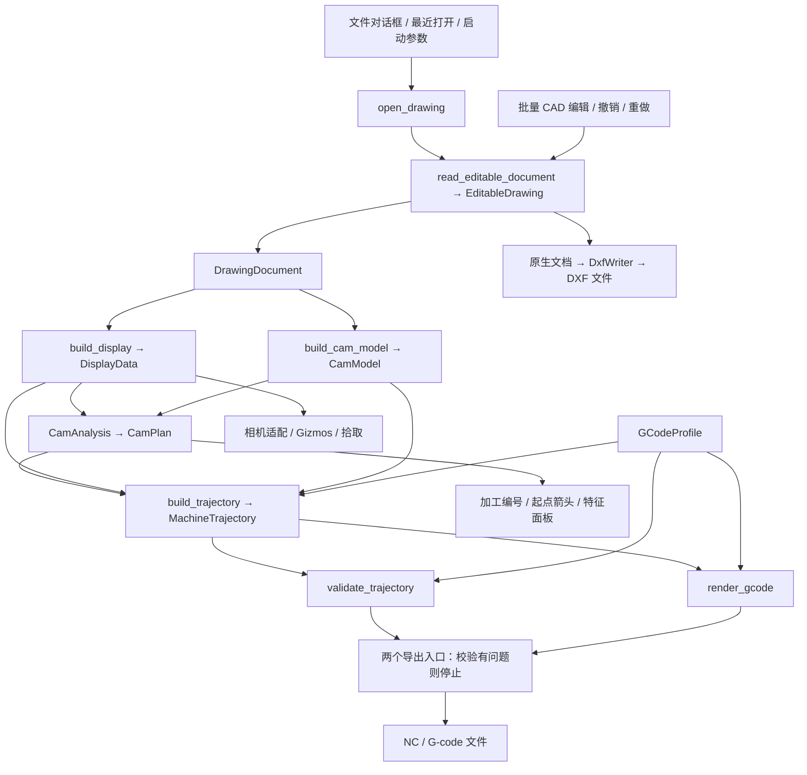

# 架构

[返回项目入口](../README.md) · [使用指南](使用指南.md) · [已知限制](已知限制.md)

本文按 2026-10-24 当前工作区源码整理，描述已实现的结构与行为。操作方法见使用指南，实现缺口集中在已知限制中。

## 分层与依赖

Workspace 包含 `cad-core` 和 `cad-app`，默认成员为 `cad-app`。依赖方向为 `cad-app → cad-core`。

| 模块 | 职责与入口 |
|---|---|
| [cad-core/src/lib.rs](../crates/cad-core/src/lib.rs) | 对外暴露 `read_document`、`read_editable_document`、`EditableDrawing`、批量编辑和独立领域模型 |
| [import/](../crates/cad-core/src/import/mod.rs) | 私有：格式识别、failsafe 解析、可用性检查、错误转换 |
| [convert.rs](../crates/cad-core/src/convert.rs) | 私有：模型空间转换、OCS 到 WCS、图层补全、单位及导入报告 |
| [edit.rs](../crates/cad-core/src/edit.rs) | 原生文档保留、稳定 ID 映射、创建/批量变换事务、撤销/重做及 DXF 写出 |
| [geometry_edit.rs](../crates/cad-core/src/geometry_edit.rs) | 工作平面绘图、相似变换及原生几何创建适配，毫米反换算到源单位 |
| [properties.rs](../crates/cad-core/src/properties.rs) | 解析夹点/半径修改、相邻段联动及原生字段写回 |
| [file_io.rs](../crates/cad-core/src/file_io.rs) | 同目录临时文件替换、覆盖前备份，供正常保存与恢复快照共用 |
| [model/](../crates/cad-core/src/model/mod.rs) | 文档、实体、图层、ID、六类几何；无 UI/渲染依赖 |
| [model/work_plane.rs](../crates/cad-core/src/model/work_plane.rs) | f64 工作平面、三点建系、局部/世界坐标转换与射线求交 |
| [snap.rs](../crates/cad-core/src/snap.rs) | 原始几何特征、曲线/NURBS 求值、近点、垂足/切点及支持组合的真实交点 |
| [cad_edit.rs](../crates/cad-app/src/cad_edit.rs) | CAD 共同/混合属性、半径/夹点、批量颜色/换层/移动/删除控件及动作 |
| [cad_layers.rs](../crates/cad-app/src/cad_layers.rs) | 图层新建/改名/删除/迁移、当前层及颜色/显示/锁定控件 |
| [cad_command.rs](../crates/cad-app/src/cad_command.rs) | 绘图/移动/变换/三点平面命令步骤、坐标输入及临时预览 |
| [cad_tools.rs](../crates/cad-app/src/cad_tools.rs) | 新图元属性、变换/阵列参数控件及矩阵生成 |
| [cad_aids.rs](../crates/cad-app/src/cad_aids.rs) | 捕捉模式、候选及标记、可选投影、网格和方向约束 |
| [cad_selection.rs](../crates/cad-app/src/cad_selection.rs) | 选择过滤、替换/追加/移除/切换及反选入口 |
| [cad_view.rs](../crates/cad-app/src/cad_view.rs) | f64 视图原点与文档/局部渲染坐标、射线和屏幕投影转换 |
| [cad_file.rs](../crates/cad-app/src/cad_file.rs) | 新建/打开/保存/关闭、未保存确认、恢复快照、单位确认及导入报告 |
| [display.rs](../crates/cad-app/src/display.rs) | `build_display`：显示折线、颜色、属性、包围盒及圆/圆弧元数据 |
| [cam.rs](../crates/cad-app/src/cam.rs) | `build_cam_model`：端点焊接、连通分组、实体到加工单元的映射 |
| [cam_analysis.rs](../crates/cad-app/src/cam_analysis.rs) | `CamAnalysis`：截面/断面、区间/组/区位、顺序、方向和起点 |
| [cam_trajectory.rs](../crates/cad-app/src/cam_trajectory.rs) | `build_trajectory`：加工路径到 X/Y/Z/A 运动及单元范围 |
| [cam_transfer.rs](../crates/cad-app/src/cam_transfer.rs) | 保护竖直段及旋转净空的空移参考曲线、XYZA 渐变和自适应线段离散 |
| [cam_wall.rs](../crates/cad-app/src/cam_wall.rs) | 内壁投影及局部斜率、壁厚单向 X 附加量 |
| [gcode.rs](../crates/cad-app/src/gcode.rs) | 配置、`validate_trajectory` 基础校验、`render_gcode` 文本生成 |
| [main.rs](../crates/cad-app/src/main.rs) | 应用状态、Bevy 系统、egui、相机、选择、重算、全屏配置及导出 |

`cad-core` 不依赖 Bevy/wgpu/egui；`acadrust` 类型限制在 import/convert/edit 边界，不进入公开领域模型。CAM 分析和轨迹模块不依赖 Bevy/egui，但目前依赖显示适配层的数据。

## 主数据流

`cad_file::open_drawing` 在主线程完成未保存确认、读取和单位确认，再由 `install_drawing` 同步生成显示、拓扑、分析和轨迹；成功后更新 `ViewerState`、增加 `load_version` 并标记相机适配。取消或失败保留原图纸。新建/关闭也通过同一安装入口清理旧选择版本、编辑历史及 CAM 手动输入。`ViewerState` 通过 `EditableDrawing` 同时持有当前领域文档及封装的原生记录；来源摘要和显示/CAM 均从该当前文档派生。

## 领域模型与导入

- `DrawingDocument` 包含单位、图层、实体、来源和导入报告。`EntityId`/`LayerId` 是内部 ID，不是文件句柄或数组下标；实体及原生图层按句柄映射，缺少原生句柄/表记录的图层以忽略大小写的名称回退。映射跨编辑及撤销/重做保留，删除不重排其他 ID；图层改名保留 ID，新层即使复用撤销后的句柄仍获新 ID。查找使用稳定 ID，不能把 ID 当数组下标。
- `Geometry` 包含 Line、Polyline、Circle、Arc、Ellipse、Spline，WCS 坐标为 `f64`；平面曲线保留平面或轴向基。
- `DrawingDocument::source_units` 表示原生记录使用的单位；单位已确认时，`units` 为毫米。转换在 OCS/WCS 几何生成后，统一缩放位置、半径及椭圆轴长，保留角度、法向、节点和权重。原生文档不整体缩放，毫米编辑位移按源单位比例反向换算；保存 DXF 保留源单位。未知单位必须由打开流程指定毫米或英寸，指定后标为未保存。
- 多段线保存直线和圆弧段，闭合段已包含在列表内；样条保存控制点、节点、权重、拟合点及源标记。
- 格式识别优先使用内容签名和特征，扩展名作回退及诊断。acadrust 使用 failsafe 解析，并拒绝没有可用绘图记录的结果。
- 转换仅处理模型空间，未支持或失败实体写入报告；最多保留 256 个跳过样本，另计省略数。解析诊断合并到警告列表。

## CAD 编辑事务、撤销/重做与 DXF 写出

`EditableDrawing` 是正式修改入口，原生 `CadDocument` 为权威数据，`DrawingDocument` 为派生快照。它封装稳定实体/图层 ID 映射和编辑历史。`DrawingEdit` 提供批量颜色、所属图层、WCS 三维平移及删除；先验证整批选择、目标图层和偏移，再修改候选原生副本并转换。若非删除对象在转换中丢失则整批取消；成功后才替换正式文档。空操作、失败和未产生模型变化的操作不增加历史或清除重做。移动使用原生 WCS/OCS 变换，重型二维多段线单独更新标高，防止仅移动顶点而遗漏导出头部的标高。ACI 显示颜色与原生完整色表一致。

`create` 将 `NewEntity` 中的解析几何适配为原生实体，保留平面法向和 OCS 标高；圆弧按扫角符号选择法向，椭圆和样条保留其原生类型。`transform` 克隆选中源实体，以“移到基点原点 → 线性变换 → 移回”的源单位变换保留原生属性；重型二维多段线同步归一化顶点及头部标高。复制重置父对象句柄/所有者，为三维多段线顶点分配新句柄；新实体始终分配新的内部 ID，即使撤销后的原生句柄被再次使用也不复用旧 ID。创建/变换和原有编辑共用候选转换及提交；新增对象无法转换时同样整批取消。

`properties::grips/move_grip` 在解析几何上修改端点、圆心/半径、椭圆轴、多段线顶点和样条控制点；多段线共用顶点联动相邻段，圆弧段保留凸度。`set_geometry` 批量更新原生字段，保留实体身份、公共属性及多段线顶点附属字段，更新的原始 DXF 缓存失效；失败不提交。周期/只有拟合点的样条不提供控制点夹点。

`LayerEdit` 操作原生层表/当前层头部和引用，层状态加入领域模型。锁定/隐藏检查集中于核心编辑入口及新建/换层目标，不能绕过控件修改。图层事务对比实体、图层和当前层，空层新增或仅改变显示/锁定也能记录历史。改名沿用原生引用更新；删除明确迁移目标，保留目标层记录。图层状态不用于构建 CAM 的排除条件。

每次有效提交分配递增事务 ID，返回包含事务 ID、影响数量、操作类型和新建 ID 的 `DrawingChange`；提交、撤销、重做共用这一通知。历史共保留最多 100 条批量操作，快照使用库的共享/COW 存储；撤销/重做交换对应原生文档及版本，再生成领域模型，已删除的实体仍使用原 ID。新编辑清除重做分支。保存版本独立记录，不随历史切换而改写，因此撤销或重做回到保存版本时清除未保存标记。`DxfWriter` 先在内存完成序列化，`file_io` 写同目录临时文件、`sync_all` 后重命名替换；覆盖目标前先以同样方式写入 `.bak` 备份。失败不更新保存版本或当前路径。源块、表和其他已解析记录保留在原生文档中，读写完整性仍取决于库支持范围。

`main.rs::apply_cad_action` 将批量 UI 和菜单/快捷键汇入同一入口，以 `DrawingChange` 决定刷新。界面上下文按核心事务 ID 保存，不另外维护一套撤销/重做顺序；随核心历史淘汰及分支清除同步释放。属性修改重建显示和轨迹，保留拓扑及加工分析；创建/移动/删除/几何变换同时重建 CAM。几何事务撤销/重做时交换加工分析、手动截面/配对及 CAD/CAM 选择上下文，再用当前 G-code 配置同步初始位置及重算。CAD 历史不单独记录 CAM 面板操作或恢复整份 G-code 配置；图层改名事务单独保存涉及名称的规则条目，撤销/重做交换这部分条目，不影响其他规则及参数。改名前若新旧键均有规则则拒绝，删除层不合并工艺规则。编辑后清理失效选择、拖框及点击重排状态。`export_dxf_file` 导出整张图纸，与两个 G-code 导出入口独立。

`cad_file::save_drawing` 为已有 DXF 写回当前路径，DWG、未命名及恢复图纸进入另存为；成功后切换文件元信息。导出副本沿用既有清除保存标记的行为，但不切换当前路径。新建、替换、关闭及退出共用保存/放弃/取消确认；禁用 Bevy 默认自动关闭，由 `WindowCloseRequested` 处理确认后发送 `AppExit`。

`FileState` 保留打开时的导入报告和本会话恢复信息。`maintain_recovery` 在首次未保存变更后、后续有版本变化且经过 30 秒时，通过 `write_recovery` 写独立 DXF；不更新正式保存版本。正常保存、放弃/替换及退出清理本会话快照，异常遗留文件可手动恢复；恢复文档清除源路径并标为未保存。恢复不包含 CAM 人工安排和历史。文件写入仍同步执行。

## 显示、坐标与选择

### 命令及工作平面

`CommandState` 持有当前 `WorkPlane`、活动步骤、临时取点及错误；不改写 `DrawingDocument` 或 `DisplayData`。菜单、Ctrl+M、左侧按钮及命令栏由 `submit_command` 统一分派。移动依次经过选择、基点、目标点和确认；基点阶段固定图元 ID，预览从显示路径临时加偏移，确认时才将 `DrawingEdit::Translate` 交给原批量事务。提交失败保留确认步骤，成功或取消清除临时状态。原数值偏移按钮保留直接提交行为。

夹点命令冻结源几何和句柄，鼠标命中由屏幕距离选取真实几何夹点。按住拖动预览，松开固定目标，再确认后返回几何更新；数值属性入口共用此路径。夹点临时平面通过原夹点，方向取图元平面或当前工作平面，存储的工作平面不改。

绘图命令保存 `Sketch` 点列及确认状态，调用解析几何构造生成临时显示；变换命令冻结选择 ID，按基点及工具参数对显示路径生成矩阵预览。连续绘图先结束取点再提交，固定点数工具取齐后等待确认；本命令的 U 只撤回未提交取点。`CommandCommit` 只在最终确认时返回创建/变换/移动意图，统一交给 `apply_cad_action`。新图元使用文档当前图层及所选颜色，副本继承源属性；提交后选择新 ID。几何变更重建 CAM，撤销/重做复用事务上下文。

三点平面在第三点有效时建系；取消或错误保留原平面。二维绝对输入由平面 U/V 转 WCS，三维绝对输入直接解释为 WCS；相对二维和极坐标位移沿 U/V，相对三维位移沿 WCS。取移动目标点时以基点为参考，三点平面的第二/三点以第一点为参考，其他首次取点以当前平面原点为参考。

`selection_input` 在活动取点步骤中截获画布点击，调用 `ViewFrame::ray` 将局部 Bevy 射线逆映射为 CAD WCS，并在 f64 中归一化方向。`DraftingAids::resolve` 先从领域模型取捕捉候选，通过 `ViewFrame` 投影限制屏幕距离，再按方向约束、网格和工作平面自由点回退；不能取合法交点时提示。选择步骤沿用点选和框选，取点阶段不再改变所选对象。渲染的青色预览、标记及平面不进入保存、拓扑或 CAM。

`snap_points` 从直线、多段线圆弧、圆、椭圆和有效样条求特征；开放样条端点由 de Boor 求值，不能计算时不使用控制点冒充端点。非直线近点采用 64 个参数区间的初始搜索与局部细化，未证明复杂样条全局最优。交点、垂足和切点按支持的线/圆弧组合计算；交点检查约 `1e-6 mm` 空间残差，排除异面直线的投影交点。邻近判断由几何计算，不依赖显示折线是否经过光标；交点限 24 个邻近图元，超出时提示。捕捉候选在约 `1e-6 mm` 内去重，Tab/Shift+Tab 循环；显式投影选项才改变捕捉点的法向位置。数值输入绕过辅助约束。

活动命令期间禁用其他 CAD 编辑和直接保存/导出，文本焦点保留文本快捷键；Esc 取消命令。切换工作区清除活动命令，成功替换文档时重置命令及工作平面。恢复快照不包含这些临时交互状态。

### 画布与选择

`DisplayData` 保留全量路径及 visible/locked 元数据，显示/拾取/捕捉独立过滤隐藏层，CAM 继续使用全量路径；包围盒仍含隐藏对象。它还保存图元属性、图层，以及独立圆/圆弧的圆心和法向。样条使用 de Boor 求值，不完整数据可回退为控制多边形；显示路径过滤非有限坐标。

`CameraRig::target` 保持 WCS f64，相机在局部原点附近朝向零点。`ViewFrame::point` 先在 f64 中减去视图原点，再按 `(x,y,z) → (x,z,-y)` 转 f32；逆变换用于鼠标射线。适应视图时，包围盒角点先减去 f64 中心再参与投影范围计算。线框、预览、工作平面、拾取和 CAM 标签共用该转换，不更改领域坐标或加工轨迹。相机仍为 f32 正交相机，局部原点解决绝对大坐标过早截断，不保证任意跨度与极限尺度。网格按当前平面围绕视图投影中心绘制，过密时稀疏显示整数倍间距，不改变实际网格捕捉间距。

`SelectionState` 分别持有实体和加工单元 ID，并记录过滤和悬停候选。CAD 拾取按局部投影线段距离、视线深度及 ID 稳定排序；Tab 循环候选、橙色预选，选择支持四种方式及 Ctrl/Alt/Shift 临时覆盖。过滤按类型、图层、颜色属性限制新选择、框选和全选；反选仅作用于过滤范围，不自动清除其他已选对象。换图通过 `load_version` 清理旧选择和过滤。窗口/交叉框选使用蓝/绿反馈；CAM 保留整单元选择与 Ctrl 重排。`UiState` 与 egui 指针状态用于阻止界面操作透传；无候选时 Tab 保留普通焦点导航。

## CAM 拓扑与分析

### 加工单元

`build_cam_model` 从领域几何取端点，以 `1e-3 mm` 容差进行空间哈希焊接及并查集分组。完整圆、完整椭圆、闭合多段线及闭合/周期样条独立成单元；开放实体连通组的节点度全为 2 时标记闭合。

`MachiningUnit.members` 按实体 ID 排序，并非加工顺序。`UnitId` 是规范化成员集合的 FNV-1a 哈希；相同内部成员集合保持同一身份，不保证源文件实体顺序变化后仍对应原对象。

### 截面、断面、区间与区位

1. 从所有闭合单元的 YZ 包络估计管材中心、尺寸和圆角；当前至多生成一个候选，单一候选自动采用。
2. 将闭合路径投影到管材周界，检查表面偏差、周向覆盖和 `±1` 绕数；周界覆盖使用 512 个桶。
3. 最大偏差不超过 `0.05` 且缺口桶数不超过 1 的高置信候选自动成为加工断面；其他候选可手动应用，也可手动指定闭合单元。
4. 断面按轴向中心位置两两配对，也可手工指定；`MachiningGroup` 保存 `left_section/right_section`，由同一组生成 `MachiningInterval`。修边及未归属单元保留在独立组，断面不再按相同最小 X 去重。普通单元按全部路径采样与两侧局部边界比较归属；交叉、重叠或归属歧义进入 `grouping_errors`，轨迹与导出共用。
5. `UnitZoneProfile` 记录区位投影长度及经过标记，以最长投影选主区位。16 区位由 4 个面、4 个圆角、8 个过渡组成，界面方位名称以 `TubeZone::label` 为准。

### 计划、方向与起点

`CamPlan → PlanGroup → PlanUnit` 保存顺序、区位、断面标记、方向和起止点。

- 懒旋转按区位遍历，再按单元 X 中心排序；关闭后按单元最小 X 排序，以区位顺序和 ID 打破并列。顺逆时针影响区位顺序。
- 组外/修边组先执行；成品组固定为左端面、普通单元、右端面。`end_cut_side` 从成品组边界推导。普通单元支持组内上下移动和 Ctrl 点击重排，插入位置限制在两端之间。
- 普通单元统一按自身几何选入口，不依赖前一单元或前一断面的出口。非懒旋转选 X 最大点；懒旋转优先局部北极点，不可用于主区位时尝试南极点，再回退到主区位内的极值点。局部北向定义为区位转至朝上加工姿态后的横向 +Y，圆角采用区位中部的切平面方向。
- 闭合单元在显示路径采样点中选极点；开放单元只在两端选，避免从中间开切漏段。懒旋转优先选择初始切向朝 +X 的遍历方向；非懒旋转按顺逆时针选择初始局部周向切向。此规则不等于强制所有 A 轴运动单向。
- 完整计划重建、上下移动和 Ctrl 重排均调用 `refresh_plan_entries`，保留当前排序并统一刷新起止点和编号。普通单元不再做前后夹角、A 角变化及距离评分。
- 切断断面保留独立入口：首断面优先从上表面靠近配置初始位置处进入，末断面尝试承接前一区位；未命中特殊规则时按前一终点选择路径正反向。非懒旋转时断面参考状态可跨组传递，懒旋转在组首重置。
- 无截面时清除截面/区位分析，按最小 X 排序，以前一终点选择方向，生成单个回退加工组。

`ordered_unit_points` 从显示路径贪心拼接加工路径，`oriented_unit_path_from` 反向或旋转闭合路径起点；尚无独立的加工公差几何层。

## 四轴运动与 G-code

`MachineTrajectory` 保存运动段、单元运动范围、规则键、安全 Z、A 范围、统计及构建错误。运动类型为 `Rapid`、`Cutting`、带平面/圆心/方向的 `Arc`。

有截面时围绕截面中心生成绕 X 的旋转姿态，按面/圆角或径向模式求 A，支持角度展开、加工 Z 偏移和闭合路径切向过切。`flat_surface` 确认前后普通单元处于同一水平面、同区位且实际 A 不变时，由 `transfer_moves` 生成联动或旧离面转移；圆角、切断边界、跨面和旋转使用净空策略。安全 Z 包含截面/图纸 YZ 矩形半对角线及正加工 Z 偏移。无截面时使用原 XYZ 和固定 A 偏移，不应用过切或加工 Z 偏移。

未启用壁厚端面补偿的单元，Z 非零且 A 变化时，`section_cut_direction` 只用各圆角采样求 `x = a*y + b*z + c` 的方向，再验证一致性；直角使用顶点相邻边，恒 X 断面直接返回零斜率。其他跨区位单元由 `fit_cut_direction` 检查整体是否有可靠的平面方向。过切点不参与方向拟合。每个姿态按 `ΔX = machining_z_offset * (a*sin(A) + b*cos(A))` 修正 X，源点自身的曲线形状保留；Y/Z/A 继续使用原姿态解算。修正先于进场、圆弧压缩和单元转移，因此入口及实际过切末姿态一致。失败返回含具体原因的空轨迹，面板显示错误，渲染返回空文本，两个导出入口均通过校验拒绝输出。

`TransferConfig` 包含默认关闭的 `smooth_enabled` 和默认 0.05 的 `smooth_tolerance`。`transfer_moves` 在已有起点且启用平滑时调用 `cam_transfer::smooth_transfer`，失败回退原有生成路径。同面保持现有峰高/占比和恒 A，只有同面联动启用时平滑；跨区位先完成竖直净空抬升，再于净空上方增加 `total_height` 的过渡空间。所有跨区位 Bézier 控制点均在共同安全平面之上，A 使用统一五次参数渐变，末段在完成 A 转位后竖直落刀。初始未知姿态不参与平滑，已知的首尾转移共用此入口。

`cam_transfer` 使用分段五次 Bézier 的光顺参考曲线，不把成品切削轮廓纳入优化。控制点与同参数直线的差界约束整个曲线偏差；de Casteljau 二分至满足 XYZ 几何预算及独立的 A 角误差/步长要求，最多 12 层、每次转移约 4096 个中间点，达限回退。`RotaryConfig::output_decimals` 由配置精度传入，几何预算扣除三轴舍入误差界，竖直保护高度向上量化并留余量。`GCodeProfile::smoothing_validation_error` 在保存和导出时拒绝不足的精度预算。参考曲线光顺不代表离散输出或控制器执行具有连续速度/加速度。

单元内部的几何 A 始终连续展开，不受 ±180° 限制。`wrap_angle_180` 归一化几何方向及偏移，`unwrap_angle` 选择靠近前点的等价角度；`align_entry_angle` 在开启连续角度时将单元入口衔接至上一末姿态，即使关闭也不让精确等价的入口多转整圈。无截面回退使用同一入口规则。结束返回同样取靠近末姿态的等价 A。`transfer_moves` 消除等价角度差，真实旋转仍经净空；交界处不拆分切削、不插入回转。角度及姿态需为有限数值，A 范围和切削段数反映实际运动。

单实体圆/圆弧在 A 恒定且符合当前识别条件时尝试压缩为圆弧运动；其余输出切削折线。文本层处理文件/单元头尾、类型/图层/颜色规则、精度和换行；关闭圆弧输出时按 `arc_tolerance` 展开语义圆弧。初始位置、首个进场及结束返回均由轨迹层生成，属于单元运动范围；文本层不自动追加首尾移动；用户配置头尾中写入的移动指令按原样输出。`TransferConfig` 是 TOML 配置、剖面示意和实际轨迹共用的参数；示例距离和高度差只存于界面状态。

运动行不再自动输出 F；速度由用户在各层级头尾代码中设定，`GCodeProfile` 和 `RotaryConfig` 不再保存统一进给字段，旧 TOML 的 `feed` 被忽略。新默认文件头尾来自 `GCodeProfile::default`，已有自定义头尾保持原值。

文本层按连续切削段启停：切削转入 `Rapid` 时先输出单元结束及规则尾部，重新切削时输出规则头部和单元开始代码，保证默认 M03/M05 包围切削段。两个导出入口消费相同的连续角度轨迹，配置窗口不生成或显示 G 代码文本。

`build_trajectory` 先生成含机床 Z 偏移、X 仍为源点 X 的姿态。启用壁厚端面补偿时，`cam_wall::end_cut_allowance` 将该实际姿态反变换到工件坐标，沿激光方向取一个壁厚的候选点，再由 `project_inner` 直接投影到内轮廓；不执行射线穿透或相切判定。局部方向以源点为锚给出内壁期望 X 与源点 X 的差值，仅对这一差值应用左端非负、右端非正的限制。该路径沿用旧项目的统一修正方式，不再额外叠加 Z/X 联动；Z 高度在基础姿态中只施加一次。内圆角小于等于零时使用直角内轮廓。补偿只修改派生姿态，源 CAD 和组归属不变；几何采样修正后延伸过切，并保留闭合末端的累计 A。所有成品组完成后检查补偿后的左右空间，失败返回明确构建错误。

普通/快速导出均重建轨迹并执行基础校验，有问题则停止，通过后才调用文本渲染。校验范围和遗漏见[已知限制](已知限制.md)。

## 状态更新入口

| 触发动作 | 当前更新路径 |
|---|---|
| 成功打开图纸 | 重建显示、拓扑、分析、初始位置参考和轨迹；清理旧选择、适配相机 |
| CAD 属性编辑 | 更新原生/领域数据、显示及轨迹，保留加工规划 |
| CAD 创建/移动/删除/变换及撤销 | 更新文档、显示、拓扑及分析，撤销几何时恢复原加工分析和选择 |
| 应用/清除截面、增删断面、面板排序或策略变化 | 更新分析/计划并重建轨迹 |
| Ctrl 点击重排 | 更新组内计划并重建轨迹 |
| 保存、导入、重载成功 / 恢复默认 / 关闭配置 | 同步初始位置参考，必要时重建计划，再重建轨迹；导入和恢复默认仅改变内存，保存才持久化 |
| 校验 / 导出 | 按当前内存配置重建轨迹并校验，导出通过后生成文本再写出；不自动保存配置 |

手动计划只保存在内存，没有加工项目持久化或独立的 CAM 撤销栈；CAD 撤销会在恢复几何时恢复关联的旧加工分析。轨迹重建统一由 `rebuild_state_trajectory` 触发，不再保留文本预览缓存。顶部配置入口打开覆盖客户区的 `egui::Modal`，阻止底层画布交互；顶栏和底栏用独立 `Panel` 固定位置，`CentralPanel` 填充剩余区域，六个导航项按实际可用高度等分。中间页最多两栏，文件与规则页共享上下头尾编辑框及右侧底部横排说明框，文件级说明使用默认空值的 `GCodeProfile::comment` 持久化且不参与文本渲染；图层及颜色规则列表按现有颜色数据绘制实体色块。安全参数和剖面示意分列；不设整体嵌套滚动，仅保留实际溢出时的局部滚动。分类说明及字段说明使用悬停提示；顶栏规则顺序与 `push_rule_headers` / `push_rule_footers` 保持一致。配置加载与保存共享 `GCodeProfile::validation_error` 检查，导入/重载失败不替换当前状态；操作结果同时显示在弹窗和命令栏。
